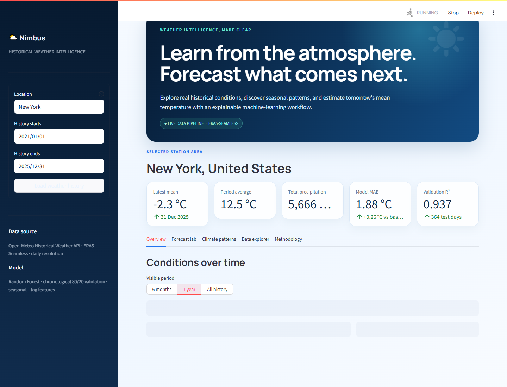
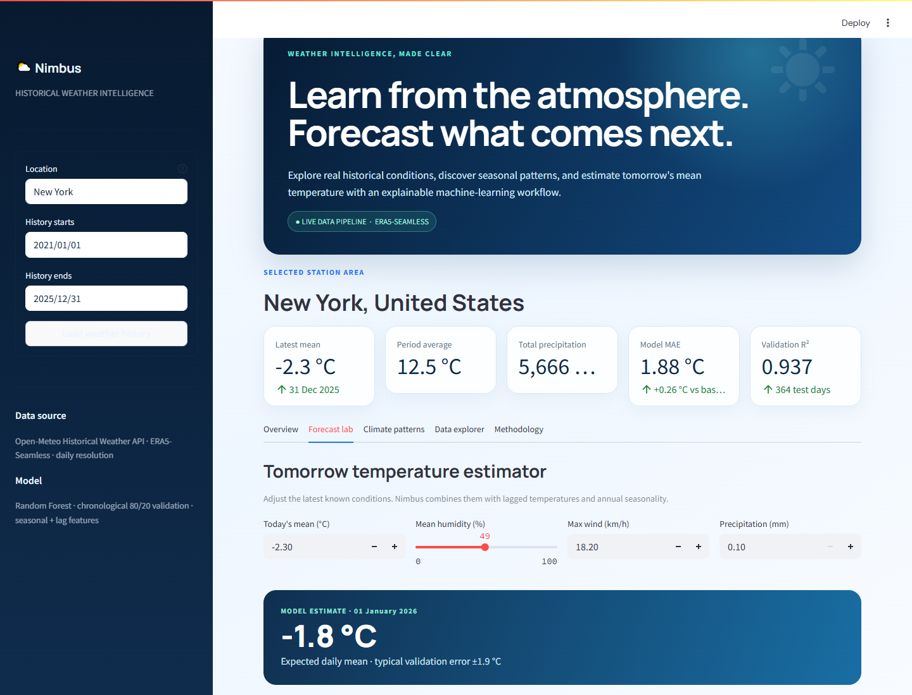
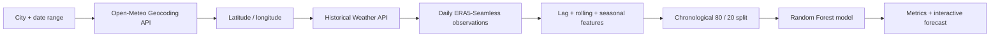

<div align="center">

# ⛅ Nimbus Weather Intelligence

**A polished Streamlit dashboard for exploring real historical weather and forecasting next-day mean temperature.**

[](https://www.python.org/)
[](https://streamlit.io/)
[](https://scikit-learn.org/)
[](https://open-meteo.com/)
[](LICENSE)
[](#project-status)

</div>



## What Nimbus does

Nimbus replaces the original ten-row sample dataset with a live, reproducible historical-weather pipeline. Enter a city and date range, and the app will:

- resolve the city to geographic coordinates;
- retrieve daily ERA5-Seamless history from the Open-Meteo archive;
- visualize temperature, humidity, precipitation, weather codes, and seasonal patterns;
- engineer lag, rolling-average, and cyclic seasonal features;
- train a 350-tree random-forest regressor with a chronological 80/20 split;
- benchmark the model against a persistence forecast;
- estimate the next day's mean temperature from adjustable conditions; and
- export the source observations as CSV.

No API key is required.

## Interface tour

### Overview

The landing view summarizes the selected location, latest observation, period climate, precipitation total, and held-out model performance. Interactive Plotly charts show daily temperature ranges, a 14-day trend, monthly moisture conditions, and observed weather types.

### Forecast lab



Adjust temperature, humidity, wind, and precipitation inputs to run a next-day estimate. The prediction is displayed with the model's typical validation error and a chart of observed versus predicted values on unseen dates.

### Climate patterns

Explore a year-by-month temperature heatmap and feature-importance chart to understand both the climate record and the model.

### Data explorer

Review every retrieved observation in a sortable table and download the exact historical data as a CSV file.

### Methodology

Read the data-to-model pipeline, validation design, sample counts, and coordinates directly inside the app.

## Quick start

```bash
git clone <your-repository-url>
cd Weather_Forecast_prediction
python -m venv .venv
```

Activate the environment, then install and run:

```bash
# Windows PowerShell
.venv\Scripts\Activate.ps1

# macOS / Linux: source .venv/bin/activate
python -m pip install --upgrade pip
pip install -r requirements.txt
streamlit run weather.py
```

Open `http://localhost:8501` if Streamlit does not open it automatically.

## Data pipeline



Nimbus requests these daily fields:

| Field | Meaning | Unit |
|---|---|---:|
| `temperature_2m_mean` | Daily mean air temperature at 2 m | °C |
| `temperature_2m_min` | Daily minimum air temperature at 2 m | °C |
| `temperature_2m_max` | Daily maximum air temperature at 2 m | °C |
| `relative_humidity_2m_mean` | Daily mean relative humidity | % |
| `precipitation_sum` | Daily total precipitation | mm |
| `wind_speed_10m_max` | Daily maximum wind speed at 10 m | km/h |
| `weather_code` | WMO weather interpretation code | code |

Data is fetched from the [Open-Meteo Historical Weather API](https://open-meteo.com/en/docs/historical-weather-api) using its ERA5-Seamless model. Responses are cached for 24 hours to keep reruns fast and considerate of the public service.

## Forecasting methodology

The target is the next day's mean temperature. Predictors include today's temperature range, humidity, precipitation, wind, one- and two-day temperature lags, a trailing seven-day mean, and sine/cosine encoding of day-of-year seasonality.

### Validation design

Weather is time-ordered, so Nimbus does **not** randomly shuffle records. The oldest 80% trains the model and the newest 20% evaluates it. This prevents future information from leaking into model training.

The dashboard reports:

- **MAE** — average absolute prediction error in °C;
- **RMSE** — error measure that penalizes large misses more strongly;
- **R²** — proportion of test-set variation explained; and
- **persistence MAE** — a baseline that assumes tomorrow equals today.

With the default New York range (2021–2025), the verified local run produced approximately **1.88 °C MAE** and **0.937 R²** on 364 held-out days. Results vary by location, selected dates, upstream data revisions, and package versions.

## Project structure

```text
Weather_Forecast_prediction/
├── assets/screenshots/
│   ├── dashboard-overview.png
│   └── forecast-lab.png
├── scripts/capture_screenshots.py
├── .gitignore
├── LICENSE
├── README.md
├── requirements-dev.txt
├── requirements.txt
└── weather.py
```

## Regenerating screenshots

Screenshot generation is optional and intended for maintainers:

```bash
pip install -r requirements-dev.txt
playwright install chromium
streamlit run weather.py --server.port 8502
python scripts/capture_screenshots.py
```

The helper waits for real dashboard data before capturing both views at 1440 × 1100.

## Design and engineering choices

- **Clear visual hierarchy:** navy, cyan, blue, and mint create a weather-focused palette with accessible contrast.
- **Responsive layout:** metrics, controls, and visualizations expand to the available width.
- **Defensive networking:** requests have timeouts, HTTP failures are handled, and empty locations produce useful messages.
- **Honest evaluation:** time-aware validation and a simple baseline keep performance claims grounded.
- **Reproducibility:** fixed random seed, bounded dependencies, transparent features, and downloadable source observations.
- **Performance:** data and trained models use Streamlit caching; the forest trains across available CPU cores.

## Troubleshooting

| Problem | Suggested fix |
|---|---|
| `Unable to prepare the dashboard` | Confirm internet access, check the city spelling, and retry. |
| Too few observations | Select at least one full year; several years give better seasonal coverage. |
| Port already in use | Run `streamlit run weather.py --server.port 8502`. |
| Plotly or Streamlit import error | Activate the environment and rerun `pip install -r requirements.txt`. |
| Slow first load | The first request downloads history and trains the model; later reruns use the cache. |

## Limitations

- This is an educational forecasting project, not an operational meteorological service.
- Historical reanalysis is gridded model data and may differ from a nearby physical station.
- The interactive estimate changes selected same-day variables, while minimum/maximum and lag values remain based on the latest historical row.
- A point prediction does not express the full uncertainty distribution or rare-event risk.
- Do not use the output for safety-critical, agricultural, aviation, marine, or emergency decisions.

## Project status

Active and locally verified on **21 November 2026** with Python 3.13, Streamlit 1.45, scikit-learn 1.7, and Plotly 6.9. The live Open-Meteo request, model training, five dashboard tabs, and screenshot workflow were exercised successfully.

## Attribution

Historical weather and geocoding are provided by [Open-Meteo](https://open-meteo.com/). Refer to Open-Meteo's documentation and data-source terms when publishing or redistributing derived work.

## License

This project is available under the [MIT License](LICENSE).
